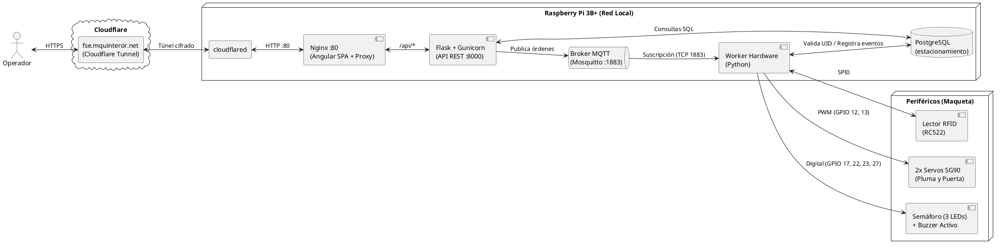
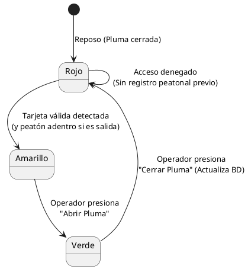
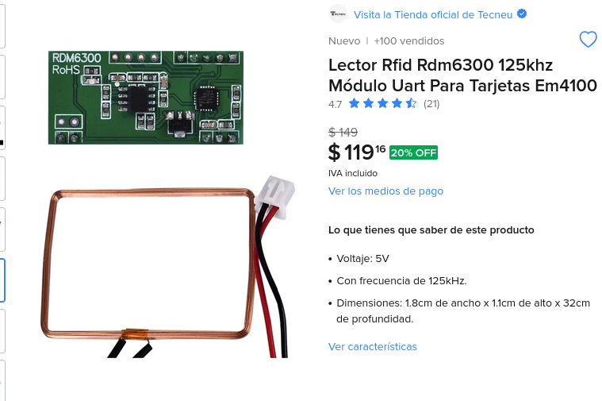
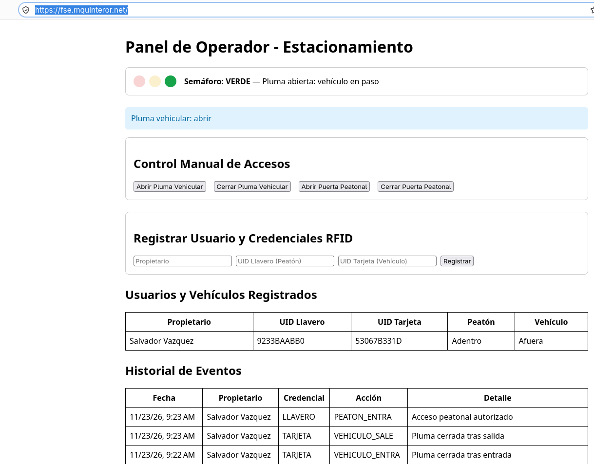
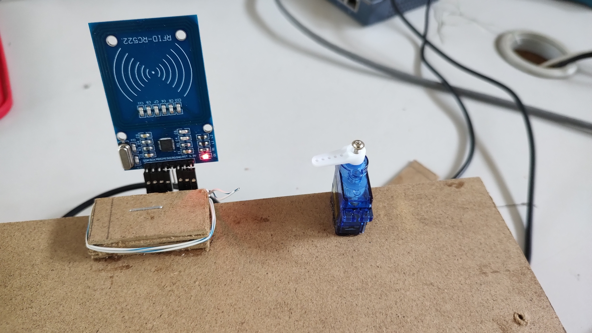
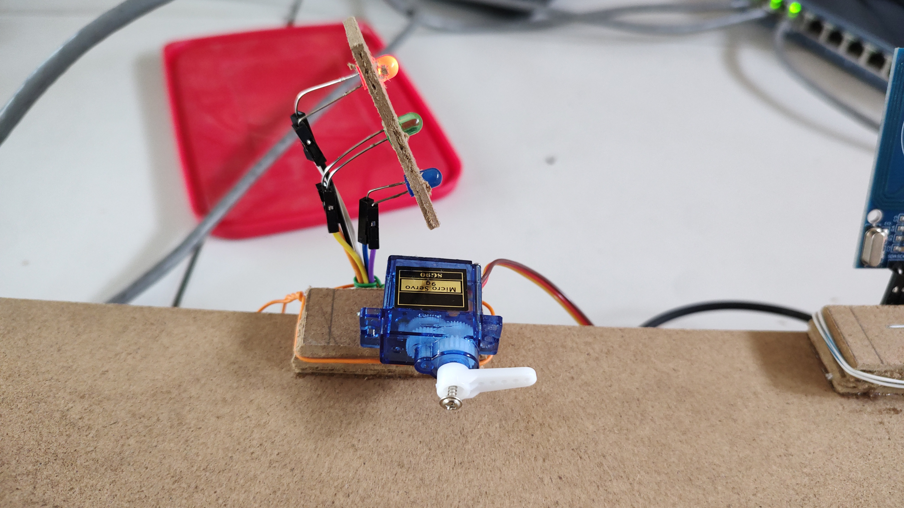
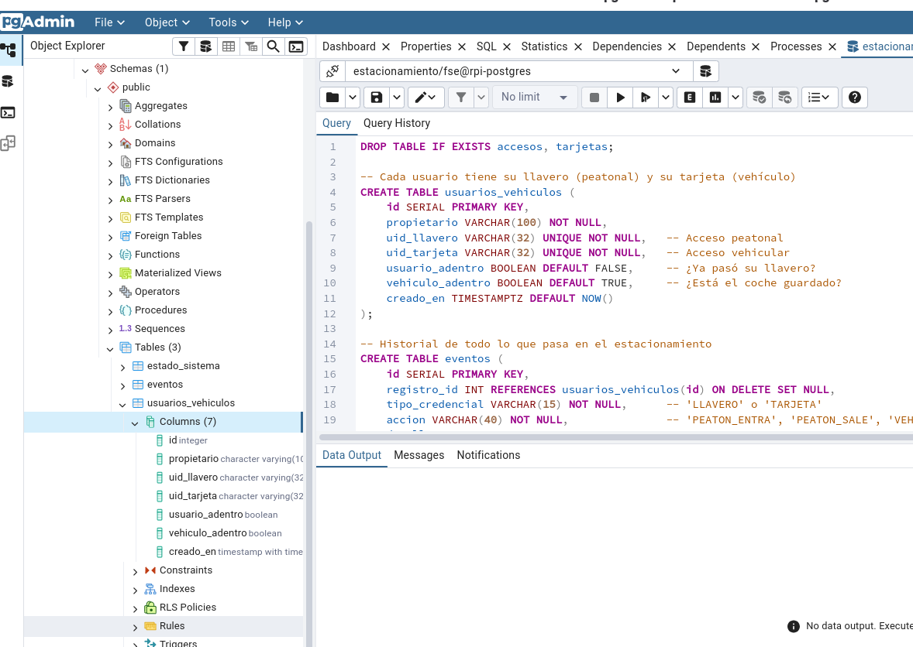
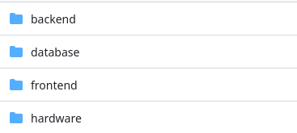

# Sistema de Control de Acceso para Estacionamiento Inteligente

## 1. Objetivo

Diseñar e implementar un prototipo de estacionamiento inteligente basado en Raspberry Pi 3B+ que integre 

- Control de acceso peatonal y vehicular mediante RFID

- Señalización visual y auditiva

- Persistencia de datos en PostgreSQL y

- Una interfaz web de monitoreo y control remoto accesible para el operador

---

## 2. Arquitectura del Sistema

La raspberrypi 3B+ Proporcionada por el profesor el el centro del sistema. En ella viven como servicios de systemd

- Una BD posgtres para guardar usuarios y los eventos ( salidas entradas de estos )

- Worker de hardware en python que maneja 
  
  - Los actuadores ( cerbomotores, leds, bocina )
  
  - El lector RFID

- Un broker mosquitto para comunicar el hardware con el backend flask  con el worker de hardware.

- Un Servicio web Backend flask y frontend angular que corre sobre gunicorn y son servidos por NGINX.

- Un tunel de cloud flare que comunica el dominio [https://fse.mquinteror.net](https://fse.mquinteror.net) con la raspberry pi. 

El sistema desacopla la capa web de la capa física mediante un broker **MQTT (Mosquitto)** y comparte el estado en tiempo real a través de **PostgreSQL**.

### 3. Lógica del negocio

Cada usuario cuenta con un **llavero RFID** (acceso peatonal) y una **tarjeta RFID** (vehículo). Para retirar un vehículo guardado, el sistema exige que el usuario haya registrado previamente su ingreso peatonal.

Diagrama de estados del semáforo

### 4. Configuración del hardware

El sistema está compuesto por los siguientes componentes

- Una Raspberry pi 3B+

- Una fuente de poder externa por USB 3.3/5V

- Dos cerbo motores SG 90

- Un lector RFID RC522

- Tres leds para el semáforo

- Un buzzer activo
  
  
  
  ### 5.  Material
  
  

Que se conectaron con la RPI 3B+ de la siguiente forma

| Componente                                | Función                      | Pin BCM          | Pin Físico         | Interfaz    |
|:----------------------------------------- |:---------------------------- |:----------------:|:------------------:|:----------- |
| **RC522 (SDA / MOSI / MISO / SCK / RST)** | Lector RFID                  | 8, 10, 9, 11, 25 | 24, 19, 21, 23, 22 | SPI0        |
| **Servo SG90 #1**                         | Pluma vehicular              | GPIO 12          | 32                 | PWM (50 Hz) |
| **Servo SG90 #2**                         | Puerta peatonal              | GPIO 13          | 33                 | PWM (50 Hz) |
| **LED Rojo**                              | Semáforo: Reposo / Denegado  | GPIO 17          | 11                 | Digital OUT |
| **LED Amarillo**                          | Semáforo: Vehículo detectado | GPIO 27          | 13                 | Digital OUT |
| **LED Verde**                             | Semáforo: Pluma abierta      | GPIO 22          | 15                 | Digital OUT |
| **Buzzer Activo**                         | Confirmación de lectura RFID | GPIO 23          | 16                 | Digital OUT |

Se tomó la decisión de usar solo un lector RFID ya que no se pudo sonseguir el **RDM6300**

### 

## 6. Funcionamiento

### Operador

El operador cuenta con su interfaz gráfica https://fse.mquinteror.net

Donde Puede abrir y cerrar las puertas 

con sus botones en la interfaz

- Peatonal
  
  

- Pluma
  
  
  
  

También pude registrar nuevos usuarios

La eliminación debería de ser de manera manual en la BD

la cual tenemos configurado un cliente en la PC de trabajo.

## 7. Código fuente

El código fuente está alojado en el repositorio

[GitHub - mquinteror1000/fse-proyecto: Proyecto Final de FSE · GitHub](https://github.com/mquinteror1000/fse-proyecto)

Y a continuación se detalla

En **backend** se encuentran los archivos:

Se encuentran los archivos

- app.py:  Conecta todos los componentes

- db.py: Aqui se guarda la conxión de la BD

En **database**

- schema.sql: Guarda la declaración de las tablas del proyecto

en **hardware**

- rfid_actuadores.py: Controla los actuadores

- rfid_reader.py: Lee las targetas y se comunica con mosquitto

En **frontend**

- Vide el proyecto sencillo de Angular para la interfaz

### Conclusiones

Realizar este proyecto fué muy productivo y me aportó mucho

- Me llevó a coocer nuevas herramientas para conectar servidores, máquinas y la Raspberry Pi

- Pude poner a pruebas las soluciones que en un proncipio propuse. Que al final con lo visto la práctica 5 resultó ser mucho más sencillo.

- Pude conocer diferentes dormas de hacer las cosas. Ahora sé que para el caso de sistemas embebidos, y procesos locales MQTT es mejor opción que HTTP.

Finalmente, se pudo integrar hardware, software y servicios de la nube en un solo sistema que trabaja en armonía.
