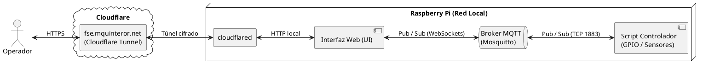

## Configuración del túnel de cloudflare.

La anterior arquitectura que involucraba una base de datos como medio de comunicación entre la interfaz de usuario y la Raspberry Pi resultó ser demasiado complicada. Afortunadamente después de hacer la práctica 5 y poner el práctica el protocolo MQTT se ha llegar a una solución mas oṕtima en la que se prescinde por completo de la nube.

Nueva arquitectura del sistema

